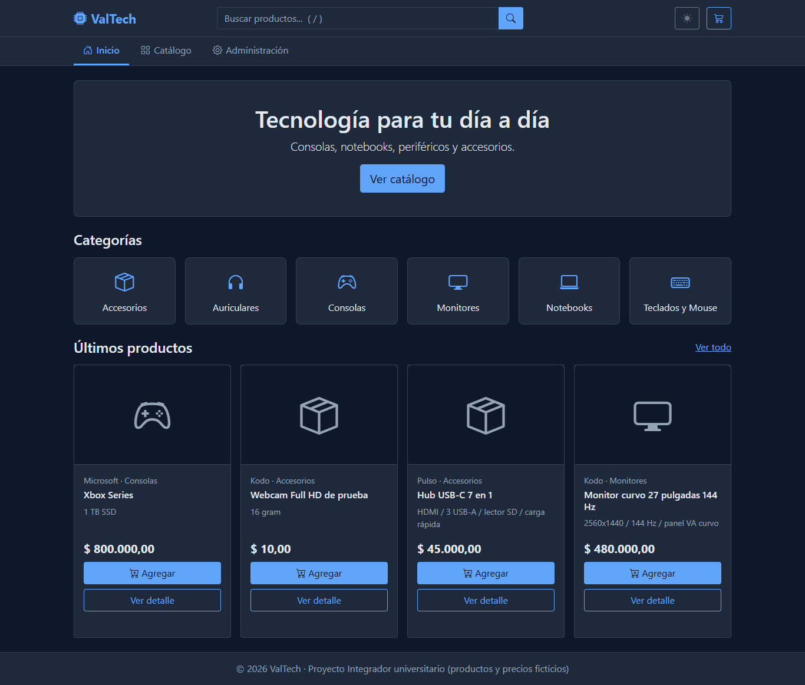
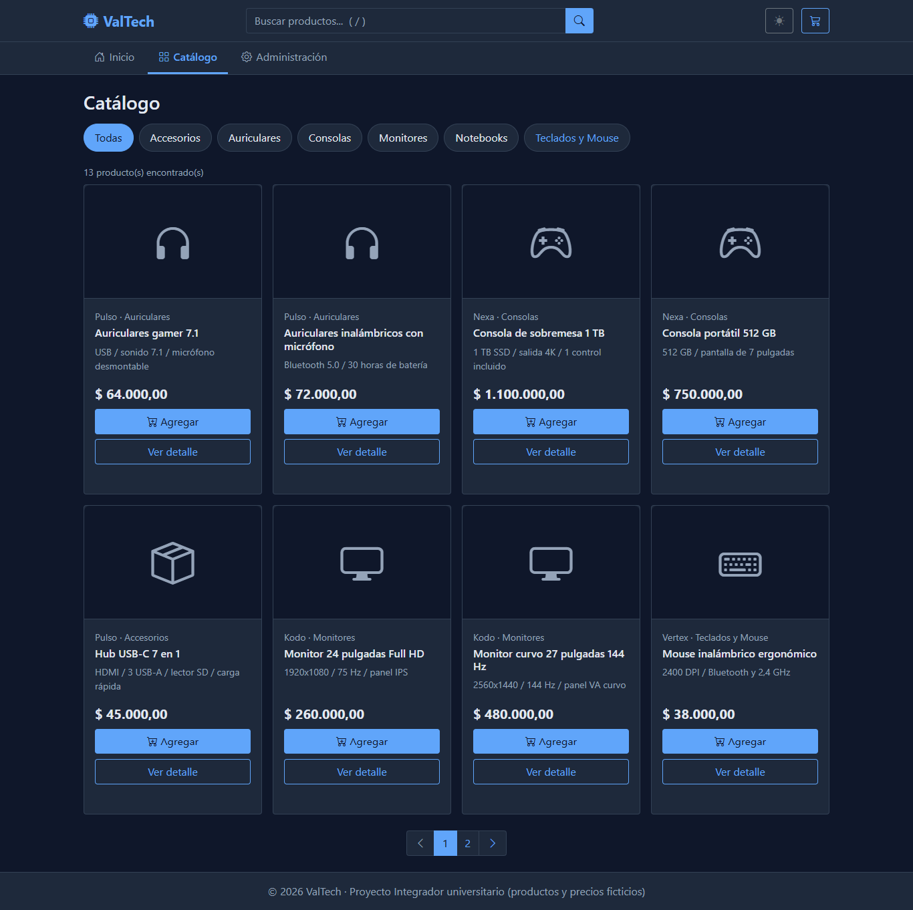
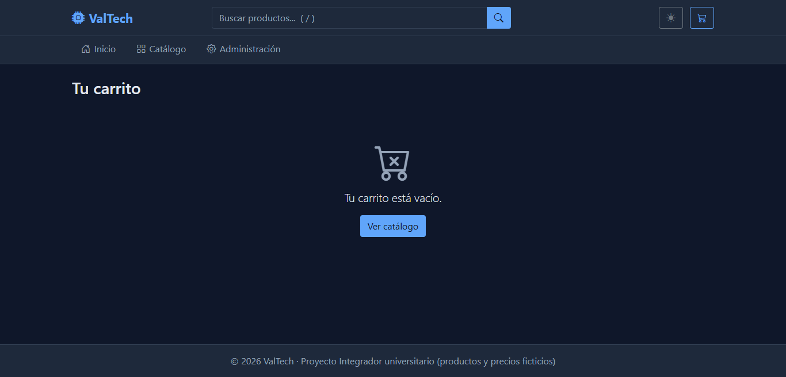
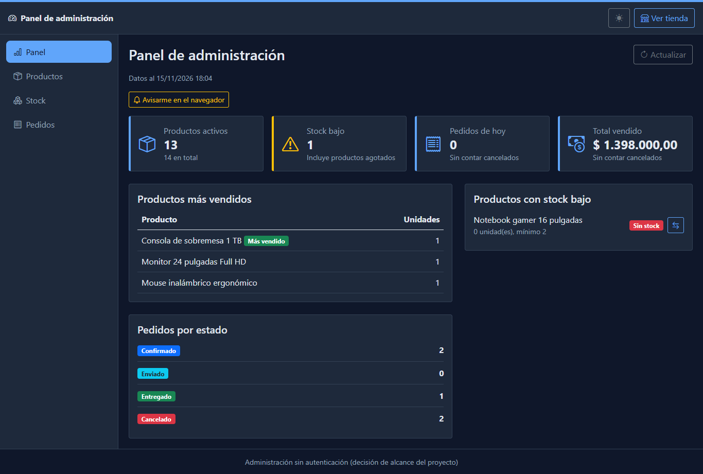
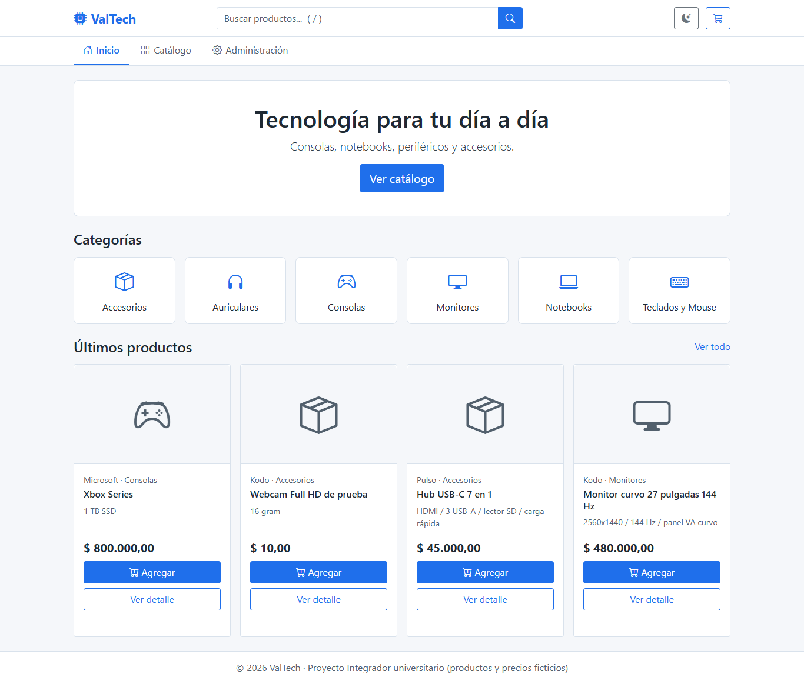
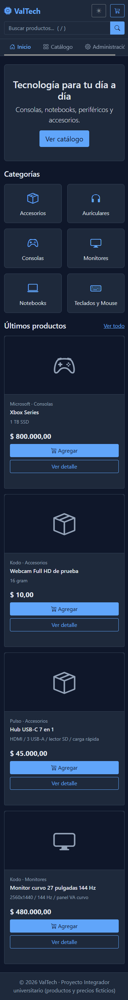
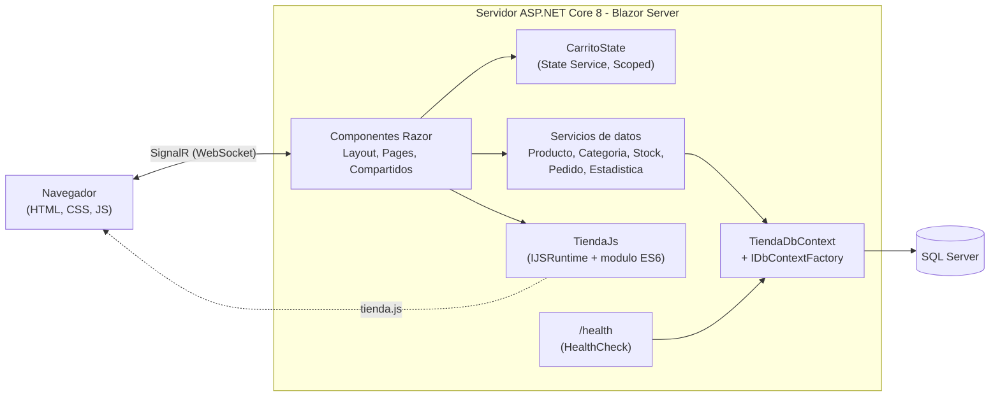
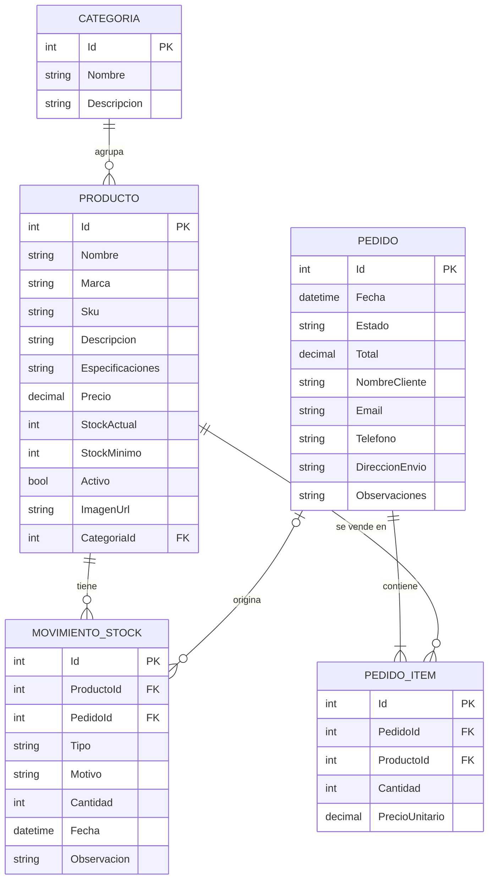
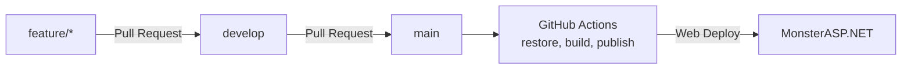

# ValTech: tienda de tecnología

[](https://github.com/V4len005/Blazor_Ecommerce/actions/workflows/publish.yml)

Tienda online de tecnología (consolas, notebooks, periféricos y accesorios) con catálogo público, carrito, checkout que genera pedidos, control de stock y un panel de administración con estadísticas. Proyecto Integrador de la materia **Desarrollo Web con Blazor** (Espacio de Definición Institucional), desarrollado de forma individual por Ibarra Valentino.

**Aplicación en línea:** https://valtech.runasp.net

> Los productos, marcas y precios son **ficticios**, creados solo para la demostración.

## Capturas

| Inicio | Catálogo |
|---|---|
|  |  |

| Carrito y checkout | Panel de administración |
|---|---|
|  |  |

| Modo oscuro | Vista móvil (375 px) |
|---|---|
|  |  |

## Funcionalidades

**Tienda pública**
- Catálogo con búsqueda, filtro por categoría y paginación real contra la base de datos.
- Detalle de producto con aviso de stock ("Sin stock", "Últimas unidades").
- Carrito con contador reactivo en el encabezado, que se conserva al recargar la página.
- Checkout con validación avanzada (la dirección es obligatoria solo si la entrega es a domicilio).
- Confirmación de pedido en una **única transacción**: se crea el pedido, se descuenta el stock y se registran los movimientos.
- El total lo calcula siempre el servidor con los precios de la base de datos.
- Modo oscuro, comprobante imprimible y botón para copiar el resumen del pedido.

**Administración** (`/admin`)
- CRUD de productos con validación (formato de SKU, reglas entre campos) y modal de confirmación.
- Stock: entradas por compra, mermas y ajustes por conteo real, con historial paginado y filtrado.
- Pedidos: lista con filtros, detalle y cambio de estado con reglas de transición (Confirmado → Enviado → Entregado; Cancelado solo desde Confirmado o Enviado, devolviendo el stock).
- Panel con estadísticas reales: productos, stock bajo, pedidos del día, total vendido, productos más vendidos y pedidos por estado. Notificación del navegador por stock bajo.

## Tecnologías

| Capa | Tecnología |
|---|---|
| Aplicación | Blazor Web App en modo servidor, .NET 8 |
| Interfaz | HTML5 semántico, CSS Isolation, Bootstrap 5 (mobile-first) y Bootstrap Icons |
| JavaScript | Módulo ES6 con `IJSRuntime` / `IJSObjectReference` (sin scripts globales) |
| Datos | Entity Framework Core 8, SQL Server, `IDbContextFactory`, migraciones (Code-First) |
| Configuración | `appsettings` por ambiente, User Secrets, `ILogger<T>`, Health Checks (`/health`) |
| Entrega | Git Flow, Conventional Commits, GitHub Actions y despliegue en MonsterASP.NET |

## Arquitectura



## Modelo de datos



## Reglas de negocio

- El stock nunca queda negativo. Si dos personas compran la última unidad a la vez, solo una lo logra (control de concurrencia).
- El dinero usa `decimal` con precisión (18,2). El precio debe ser mayor a 0.
- El catálogo público muestra solo productos activos; los agotados se marcan "Sin stock" y no se pueden agregar al carrito.
- La cantidad del carrito no supera el stock y se **revalida al confirmar** el pedido.
- Un producto con pedidos o movimientos asociados no se elimina: se desactiva.
- Cada cambio de stock deja un movimiento. Al cancelar un pedido, el stock se devuelve con un movimiento de Entrada por Cancelación.

## Cómo ejecutarlo en tu equipo

**Requisitos:** .NET 8 SDK y SQL Server (Express, LocalDB o Developer).

```bash
git clone https://github.com/V4len005/Blazor_Ecommerce.git
cd Blazor_Ecommerce

# Cadena de conexión: se guarda con User Secrets (fuera del repositorio)
dotnet user-secrets init
dotnet user-secrets set "ConnectionStrings:Default" "Server=localhost\\SQLEXPRESS;Database=TiendaTecnologia;Trusted_Connection=True;TrustServerCertificate=True;"

dotnet run
```

Al iniciar, la aplicación **crea la base de datos y aplica las migraciones** automáticamente (incluye 6 categorías y 12 productos de ejemplo). No hace falta ejecutar `dotnet ef`.

Si falta la cadena de conexión, la aplicación se detiene con un mensaje que indica cómo configurarla.

## Configuración

| Variable | Dónde se usa | Descripción |
|---|---|---|
| `ConnectionStrings:Default` | Desarrollo (User Secrets) | Conexión a SQL Server |
| `ConnectionStrings__Default` | Producción (variable de entorno) | La misma conexión, en el hosting |
| `ASPNETCORE_ENVIRONMENT` | Ambos | `Development` o `Production` |

Los archivos `appsettings*.json` **no contienen credenciales**.

El endpoint `/health` responde `Healthy` si la base de datos está disponible.

## Despliegue (CI/CD)



El workflow `.github/workflows/publish.yml` compila y publica el proyecto en cada push y Pull Request, y **despliega solo desde `main`**. Las credenciales de despliegue están guardadas como *secrets* del repositorio (`WEBSITE_NAME`, `SERVER_COMPUTER_NAME`, `SERVER_USERNAME` y `SERVER_PASSWORD`). La cadena de conexión de producción está cargada como variable de entorno en el hosting.

## Estructura del proyecto

```
Components/
  Layout/          Layouts de la tienda y de administración, menú y buscador
  Pages/           Páginas públicas (Home, Catálogo, Carrito, Checkout, Pedido)
  Pages/Admin/     Panel, productos, stock, historial y pedidos
  Compartidos/     Componentes reutilizables (ProductoCard, Paginacion, ConfirmDialog...)
Data/              TiendaDbContext y datos iniciales
Migrations/        Migraciones de EF Core
Models/            Entidades, enums y modelos de formulario
Services/          Servicios de datos, CarritoState, TiendaJs y utilidades
wwwroot/           Estilos globales y módulo JavaScript (js/tienda.js)
```

## Flujo de trabajo

- **Ramas:** `main` (producción), `develop` (integración) y `feature/*` (una por funcionalidad).
- **Commits:** [Conventional Commits](https://www.conventionalcommits.org/es/v1.0.0/) (`feat:`, `fix:`, `docs:`, `refactor:`...).
- **Tareas:** historias de usuario con criterios de aceptación en GitHub Issues, organizadas en un tablero Kanban.

## Decisiones de alcance

- **No hay autenticación:** el panel `/admin` es accesible sin iniciar sesión. Es una decisión de alcance del proyecto; en un entorno real debería protegerse.
- **El pago es simulado:** el checkout confirma el pedido sin cobrar y no integra ninguna pasarela de pago.
- **No se suben imágenes:** `ImagenUrl` es solo un texto con una dirección web; si está vacío se muestra un ícono por categoría.
- La confirmación pública de un pedido **enmascara los datos personales** del cliente.

## Changelog

Los cambios de cada versión están en [CHANGELOG.md](CHANGELOG.md).